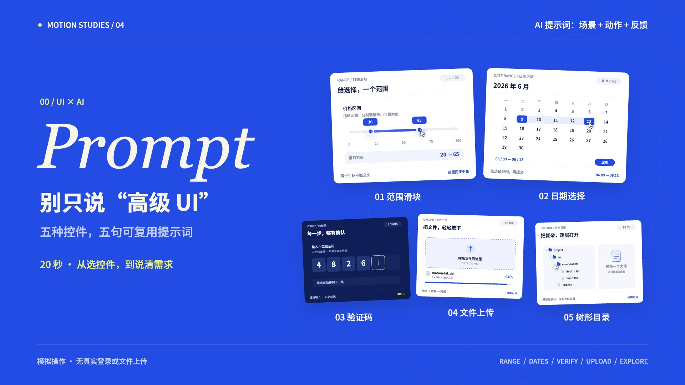

# 五种控件，怎样向 AI 描述

20 秒 / 1920×1080 / 60fps。最初的钴蓝＋柠檬黄配色，左侧场景与 AI 提示词，右侧操作演示。音乐与字幕，无旁白。



成片单独交付为 `controls-knowledge-20s.mp4`。分镜与参考来源见 [treatment.md](treatment.md)。

## 学到什么

一个实用写法：**场景 + 动作 + 反馈**。例如“做一个高级日期选择器”只给出了风格期望；补充酒店入住离店、可修改的日期区间、点击确认后生效，会更清楚地描述你需要的交互。下面是起步提示词，不保证任意模型一次生成完整产品；可以继续补充视觉参考、技术栈和业务约束。

## 五条可复制提示词

### 01 双端滑块 · 电商价格筛选

> 做价格双端滑块，数值跟随拖动，两端不可交叉。

### 02 日期选择 · 酒店入住和离店

> 做酒店日期区间选择，支持修改，点击确认才生效。

### 03 验证码 · 手机号登录

> 做六格登录验证码，自动跳格，填满后反馈校验结果。

### 04 上传 · 提交资料或导入文件

> 做资料拖拽上传，显示进度，完成后给出反馈。

### 05 树形目录 · 项目文件或知识库

> 做项目文件树，可展开，选中高亮并显示路径。

## 本片制作提示词

> 将五种控件效果短片改成 20 秒知识讲解。保留钴蓝与柠檬黄、左侧英文衬线标题和右侧 UI 的布局。每种控件同时显示适用场景与两行可复用 AI 提示词，演示要对应提示词里的动作和反馈。开场“别只说高级 UI”，结尾总结“场景 + 动作 + 反馈”。五种分别是价格双端滑块、酒店日期区间、六格验证码、资料拖拽上传、项目文件树。每段 3 秒，提示词进入场景即完整可见。用 Canvas 和纯时间函数渲染，合成 120 BPM 配乐与动作音效，输出 H.264 + AAC。

## 制作与复现

1. 逐条核对 BoardUI 控件能力，选用明确业务场景；所有数据和提交反馈均为模拟。
2. 编排 0–2 秒钩子，2–17 秒五段，每段 3 秒；17–20 秒总结提示词公式。
3. 保留原控件动画，新增场景行和提示词面板；字体本地加载。
4. 九帧检查后放大提示词字体，复查所有句子是否完整显示。
5. Python 固定随机种子生成 120 BPM 配乐和动作音；最后一个小节落主和弦并淡出。
6. Playwright 导出 1200 帧 JPG，FFmpeg 编码 H.264 Main / yuv420p / AAC，并启用 faststart。
7. 从最终 MP4 抽帧复核，并检查完整播放与多点跳转。

依赖 Node.js、Python 3、NumPy、FFmpeg 和 Chrome。

```sh
npm install
python3 -m pip install numpy
python3 make_audio.py
node render.mjs
node render.mjs full
sh encode.sh
```

默认使用 macOS Chrome，其他系统设置 `CHROME_PATH`。安装 huashu-motion 后可用 `npx huashu-motion studio . --no-open` 预览时间线。

`index.html` 是动画画布，`window.draw(t)` 可定位 0–20 秒任意时刻。本包展示模拟操作，不包含真实登录或服务端上传。

字体 Noto Sans SC 随附 OFL 许可，GSAP 和 OM 许可在 vendor 中，英文标题使用系统 Georgia。参考 BoardUI 的交互类型，未复制原站源码。
